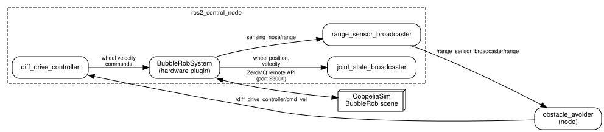

# bubble_rob_control

ros2_control for BubbleRob, the two-wheeled robot of the CoppeliaSim tutorials. A hardware
plugin drives the robot in CoppeliaSim 4.10 through the ZeroMQ remote API, and
`diff_drive_controller` turns `cmd_vel` into wheel velocities. A small node,
`obstacle_avoider`, drives forward and backs up when the nose sensor sees an obstacle.



Tested on Ubuntu 22.04 with ROS 2 Humble and CoppeliaSim Edu 4.10.

## Build

```bash
# CoppeliaSim's C++ ZeroMQ client is compiled from the CoppeliaSim folder
export COPPELIASIM_ROOT_DIR=$HOME/CoppeliaSim_Edu_V4_10_0_rev0_Ubuntu22_04
cd ~/ros2_ws
rosdep install --from-paths src --ignore-src -y
colcon build --packages-select bubble_rob_control
source install/setup.bash
```

The first build downloads jsoncons and cppzmq, which CoppeliaSim's client needs.

## Run

Without CoppeliaSim, with ros2_control's mock hardware (the sensor reads 1 m, no obstacle):

```bash
ros2 launch bubble_rob_control bubble_rob.launch.py hardware:=mock
```

With CoppeliaSim:

1. Start CoppeliaSim and open a BubbleRob scene in which no script drives the motors.
   The scene must contain `/bubbleRob/LeftMotor`, `/bubbleRob/RightMotor` and
   `/bubbleRob/SensingNose`. Leave the simulation stopped: the plugin starts it.
2. Start ros2_control and the controllers:
   ```bash
   ros2 launch bubble_rob_control bubble_rob.launch.py
   ```
3. Drive the robot by hand:
   ```bash
   ros2 topic pub -r 10 /diff_drive_controller/cmd_vel geometry_msgs/msg/TwistStamped \
       "{header: {frame_id: base_link}, twist: {linear: {x: 0.1}, angular: {z: 0.5}}}"
   ```
   or start the obstacle avoider, which the launch file does not start:
   ```bash
   ros2 run bubble_rob_control obstacle_avoider --ros-args \
       -r cmd_vel:=/diff_drive_controller/cmd_vel -r range:=/range_sensor_broadcaster/range
   ```

## Launch file

`launch/bubble_rob.launch.py` starts `robot_state_publisher`, `ros2_control_node` and the
spawners of the three controllers. `diff_drive_controller` is spawned after
`joint_state_broadcaster` is active.

| Argument   | Default       | Values                 | Meaning                                       |
|------------|---------------|------------------------|-----------------------------------------------|
| `hardware` | `coppeliasim` | `coppeliasim`, `mock`  | hardware plugin used in the `<ros2_control>` tag |

## ROS interfaces

Topics, with the default names of the launch file:

| Topic                              | Type                          | Direction | Content                                  |
|------------------------------------|-------------------------------|-----------|------------------------------------------|
| `/diff_drive_controller/cmd_vel`   | `geometry_msgs/msg/TwistStamped` | in     | robot velocity in `base_link` [m/s, rad/s]; the robot stops 0.5 s after the last message |
| `/diff_drive_controller/odom`      | `nav_msgs/msg/Odometry`       | out       | odometry from the wheel angles, `odom` → `base_link` |
| `/tf`                              | `tf2_msgs/msg/TFMessage`      | out       | `odom` → `base_link` (diff drive), wheel joints (robot_state_publisher) |
| `/joint_states`                    | `sensor_msgs/msg/JointState`  | out       | wheel positions [rad] and velocities [rad/s] |
| `/range_sensor_broadcaster/range`  | `sensor_msgs/msg/Range`       | out       | nose sensor distance [m] in `base_link`, `+inf` when nothing is detected |
| `/robot_description`               | `std_msgs/msg/String`         | out       | URDF generated from `urdf/bubble_rob.urdf.xacro` |

> On Jazzy and later `diff_drive_controller` accepts only `TwistStamped` on `~/cmd_vel`;
> on Humble this is the default (`use_stamped_vel: true`).

The package defines no services or actions. The controller manager provides the usual
`/controller_manager/*` services (`ros2 control list_controllers`, ...).

## Node `obstacle_avoider`

Publishes at 20 Hz. It drives forward; when the range is within `[min_range, max_range]` it
backs up while turning for `reverse_time`. It sends zero velocity if no range message
arrives for `sensor_timeout`.

| Topic     | Type                             | Direction |
|-----------|----------------------------------|-----------|
| `cmd_vel` | `geometry_msgs/msg/TwistStamped` | out       |
| `range`   | `sensor_msgs/msg/Range`          | in        |

| Parameter        | Type   | Default  | Unit  |
|------------------|--------|----------|-------|
| `forward_speed`  | double | `0.28`   | m/s   |
| `reverse_speed`  | double | `-0.105` | m/s   |
| `reverse_turn`   | double | `0.35`   | rad/s |
| `reverse_time`   | double | `3.0`    | s     |
| `sensor_timeout` | double | `1.0`    | s     |

## Hardware plugin `bubble_rob_control/BubbleRobSystem`

Set in the `<ros2_control>` tag of `urdf/bubble_rob.urdf.xacro`.

| Hardware parameter | Type   | Default     | Unit | Meaning                                         |
|--------------------|--------|-------------|------|-------------------------------------------------|
| `host`             | string | `localhost` | –    | host of the CoppeliaSim ZeroMQ server           |
| `port`             | int    | `23000`     | –    | port of the CoppeliaSim ZeroMQ server           |
| `time_step`        | double | `0.01`      | s    | simulation time step; must equal `1 / update_rate` |
| `lockstep`         | bool   | `true`      | –    | advance the simulation by one step per control cycle |

| Element                       | Parameter  | Interfaces                                                   |
|-------------------------------|------------|--------------------------------------------------------------|
| `left_wheel_joint`, `right_wheel_joint` | `sim_path` | command `velocity` [rad/s]; state `position` [rad], `velocity` [rad/s] |
| `sensing_nose` (sensor)       | `sim_path` | state `range` [m]                                            |

The wheel `position` is unwrapped: it keeps growing past ±π, so the odometry does not jump.

## Controllers

`config/controllers.yaml`:

| Controller                 | Type                                            | Notes |
|----------------------------|-------------------------------------------------|-------|
| `joint_state_broadcaster`  | `joint_state_broadcaster/JointStateBroadcaster` | |
| `diff_drive_controller`    | `diff_drive_controller/DiffDriveController`     | wheel separation 0.20 m, radius 0.04 m, ±0.30 m/s, ±2.0 rad/s |
| `range_sensor_broadcaster` | `range_sensor_broadcaster/RangeSensorBroadcaster` | `max_range` 0.2 m: set it to the detection range of `SensingNose` |

`update_rate` is 100 Hz. If you change it, change `time_step` in the URDF too.

## Documentation

The API reference and this page are built with Doxygen and Sphinx:

```bash
doxygen docs/Doxyfile
sphinx-build -W --keep-going -b html docs docs/_build/html
```

Open `docs/_build/html/index.html`.

## License

BSD-3-Clause, see `LICENSE`.
