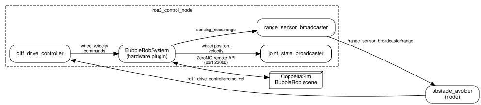

# Architecture

## Data flow in one control cycle

`ros2_control_node` runs the loop at `update_rate` (100 Hz, `config/controllers.yaml`):

1. `BubbleRobSystem::read()` asks CoppeliaSim for the wheel angles and velocities and the
   proximity sensor reading, and stores them in the state interfaces.
2. The controllers run: `joint_state_broadcaster` and `range_sensor_broadcaster` publish the
   states; `diff_drive_controller` integrates the odometry and turns the latest `cmd_vel`
   into one velocity per wheel [rad/s].
3. `BubbleRobSystem::write()` sends the wheel velocities and, with `lockstep` true, calls
   `sim.step()`: CoppeliaSim advances by exactly one `time_step`.

## Lockstep

With `lockstep` true, CoppeliaSim runs in stepping mode and one control cycle is one
simulation step. Simulation time therefore advances by `time_step` per cycle, which is why
`time_step` must be `1 / update_rate`. If the machine is too slow for 100 Hz, the
simulation runs slower than real time but stays consistent with the controllers.

With `lockstep` false CoppeliaSim runs freely, and the controllers read whatever state the
simulator has at that moment.

## Frames

| Frame       | Published by            | Notes                                         |
|-------------|-------------------------|-----------------------------------------------|
| `odom`      | `diff_drive_controller` | fixed world frame of the odometry             |
| `base_link` | `diff_drive_controller` | robot body; `cmd_vel` and `range` use it      |
| `left_wheel`, `right_wheel` | `robot_state_publisher` | rotate about +y; positive is forward |

## Lifecycle of the plugin

| Transition      | What the plugin does                                                 |
|-----------------|----------------------------------------------------------------------|
| `on_init`       | reads the URDF parameters; no connection yet                        |
| `on_configure`  | connects to CoppeliaSim and looks up all `sim_path`s                |
| `on_activate`   | sets the time step and stepping mode, starts the simulation         |
| `on_deactivate` | sets the wheel velocities to 0, stops the simulation                |
| `on_cleanup`    | closes the connection                                                |
